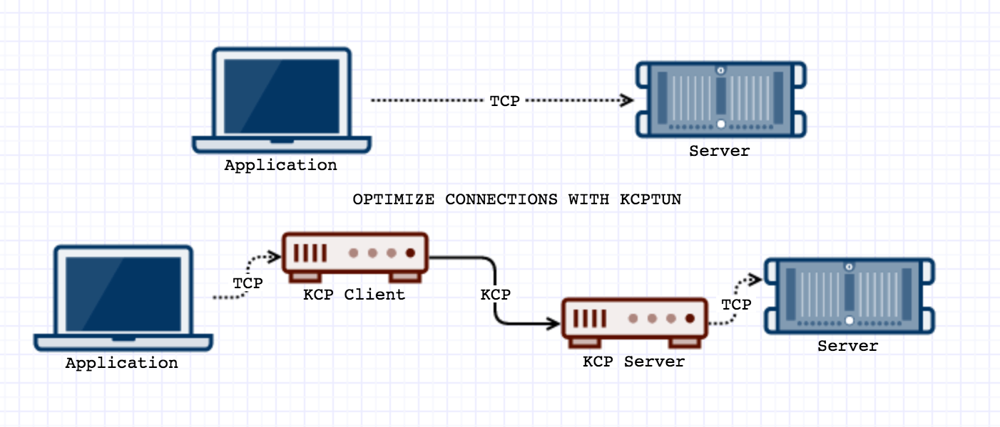

<p align="center">
  
</p>

<p align="center">
  <a href="https://github.com/skywind3000/kcp"></a>
  <a href="LICENSE"></a>
  <a href="https://github.com/liudf0716/xkcptun/pulls"></a>
  <a href="https://github.com/liudf0716/xkcptun/issues"></a>
  
</p>

# xkcptun

**xkcptun** 是基于 [KCP](https://github.com/skywind3000/kcp) 与 [libevent2](https://github.com/libevent/libevent) 使用纯 C 语言实现的高性能网络加速隧道，专为 **OpenWrt 路由器、嵌入式设备及 Linux 服务器**优化。

<p align="center">
  
</p>

---

## 核心特性

* **纯 C 极致轻量**：极低的内存与 Flash 占用，适合路由器与嵌入式设备长期稳定运行。
* **多模式多隧道并发**：单客户端支持同时配置多个 `[[tunnel]]`，涵盖：
  * `forward`：固定目标 TCP 端口转发
  * `socks5`：内置 SOCKS5 代理隧道（支持 `socks5_proxy` 上游代理回退）
  * `redir`：Linux / OpenWrt `iptables`/`nftables` TCP 透明代理
  * `proto = "udp"`：直通 UDP 报文转发（如 DNS 加速）
* **Reed-Solomon FEC 前向纠错**：内置 `fec.c` 纠错引擎，高丢包弱网下无需重传即可恢复数据分片。
* **实时监控与速率统计**：内置 `xkcp_mon` JSON 监控接口与 `xkcp_spy` 命令行工具，实时查看隧道状态、收发流量与速率。
* **现代 TOML 配置**：统一使用结构化 TOML 配置（`client.toml` / `server.toml`），支持按网卡名、`0.0.0.0`/`any` 或指定 IPv4 绑定监听地址。

---

## 编译与安装

### 1. 环境依赖

* **Ubuntu / Debian**：
  ```bash
  sudo apt-get update
  sudo apt-get install -y build-essential cmake pkg-config libevent-dev
  ```
  > `CMakeLists.txt` 默认会在缺少依赖时尝试通过 `apt-get` 自动安装；如需关闭自动安装，可传 `-DAUTO_INSTALL_DEPS=OFF`。
* **CentOS 7+ / RHEL / Rocky / AlmaLinux**：
  ```bash
  sudo yum install -y gcc gcc-c++ make cmake pkgconfig libevent-devel
  ```

### 2. 编译构建

```bash
git clone https://github.com/liudf0716/xkcptun.git
cd xkcptun
cmake -B build
cmake --build build -j
sudo cmake --install build
```

编译完成后将生成三个可执行文件（默认安装至 `/usr/local/bin/`）：
* `xkcp_server`：服务端程序
* `xkcp_client`：客户端程序
* `xkcp_spy`：本地/远程运行状态与流量速率监控工具

### 3. OpenWrt 安装（24.10+）

```bash
apk update && apk add xkcptun
```

---

## 快速上手（TOML 配置）

现代版本 `xkcptun` 采用 **TOML** 配置文件（参考仓库根目录的 [server.toml](server.toml) 与 [client.toml](client.toml)）。

### 1. 服务端配置（`/etc/xkcptun/server.toml`）

假设服务端开放 UDP 端口 `9089`（请确保云服务器安全组与本地防火墙放行 UDP `9089`）：

```toml
[global]
syslog = true
mon_port = 9087
local_address = "0.0.0.0" # 也可填写具体网卡名如 "eth0" 或指定 IP
local_port = 9089
key = "your-secret-key"
mode = "fast3"
mtu = 1350
sndwnd = 1024
rcvwnd = 1024
datashard = 10
parityshard = 3
fec = 1
sockbuf = 4194304
keepalive = 10
# 可选：若需固定默认转发目标，可同时指定 remote_addr / remote_port
# remote_addr = "127.0.0.1"
# remote_port = 80
```

### 2. 客户端配置（`client.toml`）

```toml
[global]
syslog = false
mon_port = 9086
key = "your-secret-key"
remote_addr = "your-server-ip"
remote_port = 9089
mode = "fast3"
mtu = 1350
sndwnd = 1024
rcvwnd = 1024
datashard = 10
parityshard = 3
fec = 1
sockbuf = 4194304
keepalive = 10

# 示例 1：固定目标 TCP 端口转发（本地 9088 -> 服务端 127.0.0.1:80）
[[tunnel]]
name = "web_forward"
local_address = "127.0.0.1" # 填 "any" 或 "0.0.0.0" 监听全网卡
local_port = 9088
target_addr = "127.0.0.1"
target_port = 80

# 示例 2：内置 SOCKS5 代理隧道
[[tunnel]]
name = "socks5_proxy"
proxy_type = "socks5"
local_address = "127.0.0.1"
local_port = 1080

# 示例 3：UDP 转发（如 DNS 加速）
[[tunnel]]
name = "dns_udp"
proto = "udp"
local_address = "127.0.0.1"
local_port = 5353
target_addr = "8.8.8.8"
target_port = 53
```

> **提示**：`mode` 字段（`fast3`/`fast2`/`fast`/`normal`）会覆盖 `nodelay`、`interval`、`resend`、`nc` 四个参数（与官方 kcptun 一致）。如需手动精细调优，请设置 `mode = "manual"` 或省略 `mode`。

### 3. 启动与 systemd 守护部署

前台调试运行：

```bash
xkcp_server -c server.toml -f -d 7
xkcp_client -c client.toml -f -d 7
```

生产后台运行可去掉 `-f` 并将 `-d` 设为 `0`~`2`，或使用仓库提供的 [xkcptun.service](xkcptun.service) 部署为 systemd 服务：

```bash
sudo mkdir -p /etc/xkcptun
sudo cp server.toml /etc/xkcptun/server.toml
sudo cp xkcptun.service /etc/systemd/system/
sudo systemctl daemon-reload
sudo systemctl enable --now xkcptun
```

---

## FEC 前向纠错

`xkcptun` 默认开启 Reed-Solomon 前向纠错（`fec = 1`，可通过 `fec = 0` 关闭）：

* 启用后，UDP 报文会携带 8 字节帧头，并按 `datashard`/`parityshard` 分组生成校验分片；接收端收到组内任意 `datashard` 个分片即可还原全部数据，无需等待重传。
* 零散低流量包会直接发送，**不增加额外组包延迟**；KCP 的 MTU 会自动下调 8 字节以容纳 FEC 帧头。
* **两端必须同时启用或同时关闭**，且 `datashard`（1~64）与 `parityshard`（0~64）取值一致。链路较差时可适当增大 `parityshard`；低丢包链路可设 `fec = 0` 节省带宽。

---

## 测试与状态监控

验证本地转发：

```bash
curl http://127.0.0.1:9088
```

通过 `xkcp_spy` 查看服务端/客户端实时状态与流量速率：

```bash
xkcp_spy -h 127.0.0.1 -s -t status
xkcp_spy -h 127.0.0.1 -c -t status
```

---

## 参考文档

1. [Benchmark 性能对比测试报告](BENCHMARK.md)
2. [AW 上大文件下载 EOF：xkcptun UDP 接收缓冲区排查与修复说明](AW-UDP-RX-BUFFER-EOF.md)
3. [安装 libjson-c 的问题](https://github.com/liudf0716/xkcptun/wiki/%E5%AE%89%E8%A3%85libjson-c%E7%9A%84%E9%97%AE%E9%A2%98)
4. [BBR vs KCP 优化 HTTP 下载性能对比报告](https://github.com/liudf0716/xkcptun/wiki/bbr-vs-kcp-%E4%BC%98%E5%8C%96http%E4%B8%8B%E8%BD%BD%E6%80%A7%E8%83%BD%E5%AF%B9%E6%AF%94%E6%8A%A5%E5%91%8A)

---

## 参与贡献 & 交流

* 欢迎提交 [Issues](https://github.com/liudf0716/xkcptun/issues/new) 或 Pull Request，详情请参考 [CONTRIBUTING.md](CONTRIBUTING.md) / [CONTRIBUTING_CN.md](CONTRIBUTING_CN.md)。
* QQ 群：[331230369](https://jq.qq.com/?_wv=1027&k=47QGEhL)
